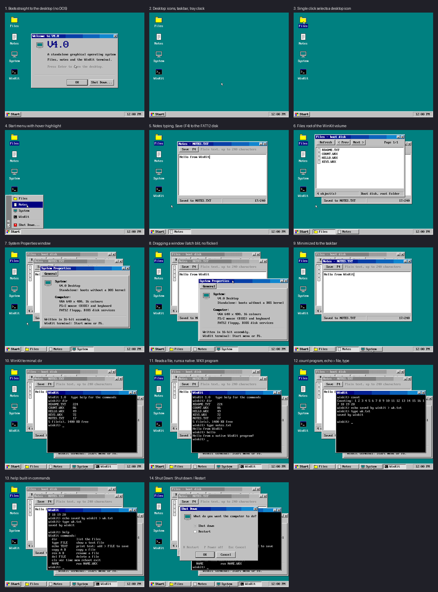

# WinKit

A small standalone operating system written in 16-bit x86 assembly: a
Windows 98-style desktop and its own terminal, **WinKit**. It boots from its
own boot sector. There is no DOS underneath; disk access goes through the BIOS
and the kernel's own FAT12 driver.

> ## Maintenance status
>
> **I am not maintaining this project.** I update it whenever I feel like it.
> There may be the occasional minor update, but when an update does come it
> will usually be a substantial one. There is no schedule and no promise of
> support.

## What it has

- **Desktop:** teal wallpaper, silver 3D-bevelled windows with gradient title
  bars, Start menu, taskbar with window buttons and a clock, desktop icons,
  minimize and close, flicker-free window dragging.
- **Apps:** Files (lists the disk), Notes (a text editor that saves to disk),
  System Properties, the WinKit terminal, and the Store. Start > Programs
  lists every program on the disk and runs it with a click.
- **WinKit terminal:** `help dir type echo copy ren del cls ver time mem
  reboot exit`, `echo TEXT > FILE`, and it runs native `.WKX` programs.
- **Setup:** `SETUP.WKX` (Start > Programs > SETUP) installs WinKit on a
  hard disk, which then boots without the floppy.
- **FAT12 driver:** read, write, delete and rename on a 1.44 MB volume (the
  floppy image, or the hard disk after Setup), through BIOS INT 13h.
- **Native programs:** flat binaries that talk to the system through
  `INT 80h`: terminal text and keys, saving a file, and a window of their
  own with drawing and mouse clicks. Run one from Start > Programs, by
  clicking it in Files, or by typing its name in the terminal. Examples are in [`src/progs`](src/progs).
- **WinKit Store:** a windowed program (`WKSTORE.WKX`; Start > Store, the
  desktop icon or F7) that downloads windowed programs from a store server
  on the host, installs them on the disk and runs them. There is no network: the link is the
  serial port (`python scripts/run.py --store`). The programs on offer are
  in [`store`](store).

## Try it

You need Python 3.8+ and [QEMU](https://www.qemu.org). Nothing else: WinKit
comes with its own assembler ([`scripts/wkasm.py`](scripts/wkasm.py)), so
there is no third-party tool chain.

    python scripts/mkimage.py        # assemble everything -> out/winkit.img
    python scripts/run.py            # boot it in a QEMU window
    python scripts/test.py           # boot it headless and check every feature
    python scripts/test_wkasm.py     # self-test of the assembler
    python scripts/showcase.py       # screenshots of every feature

See [BUILDING.md](BUILDING.md) for the controls, the terminal and how the code
is organised.

## Writing programs

> **WinKit is not DOS and will never be DOS.** AI agents and newcomers: read
> [AGENTS.md](AGENTS.md) first, so you do not assume DOS features that do not
> exist here.

WinKit runs its own native programs (`.WKX`). The complete guide, written for
both people and AI agents, is
[docs/WKX-PROGRAMMING.md](docs/WKX-PROGRAMMING.md): the execution
environment, every system call, the assembler dialect, how to build and test,
and worked examples. Drop a `.ASM` into [`src/progs`](src/progs) and rebuild.

## Limits

- One-level volume (no folders); files up to 52 KB; Notes holds 240 characters.
- WinKit programs cannot be interrupted; a program that never exits needs a
  reset.
- Existing DOS programs do not run: they need DOS's INT 21h services, which
  WinKit deliberately does not provide.
- Tested in QEMU only, not on physical hardware.

## License

Copyright (C) 2026 TerminalDev-1.

WinKit is free software, released under the **GNU General Public License,
version 3**. See [LICENSE](LICENSE). It comes with no warranty.

No code from Microsoft or from any DOS is included. The assembler
(`scripts/wkasm.py`) is original; it was checked against Microsoft's MASM 5.10
by assembling the whole system with both and comparing the output byte for
byte.
