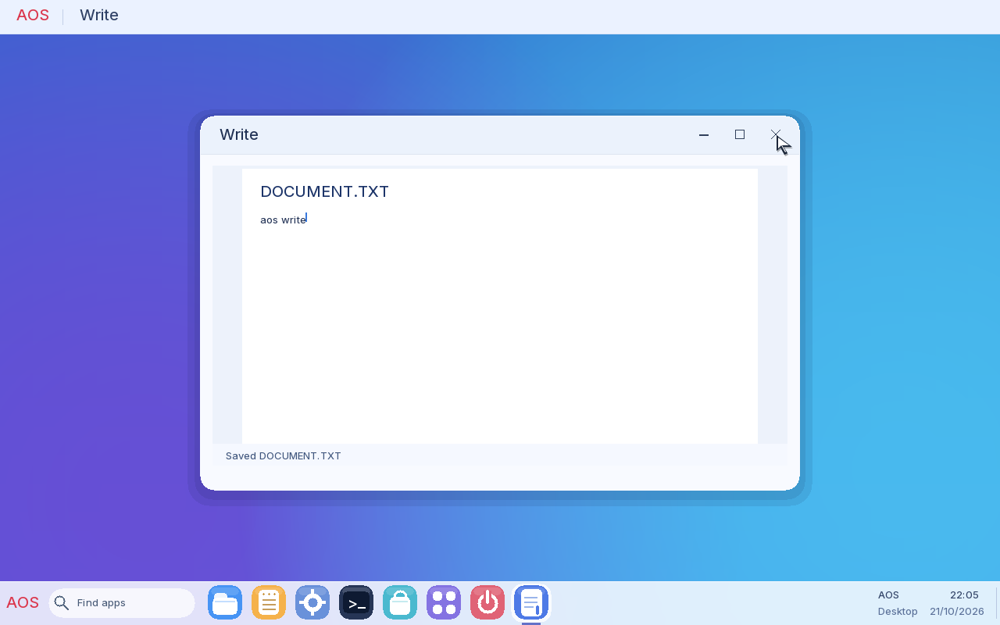

# AOS

AOS is an experimental 64-bit x86-64 operating system that boots through UEFI.
It has a freestanding Rust kernel and a full-colour desktop with AOS's own
purple/blue wallpaper, rounded light windows, an application taskbar and a
searchable Start menu. It supports keyboard and mouse input, a FAT12
filesystem, Files, Notes, Write,
Terminal, Programs and a small serial-backed Store. Native `.AIS` applications
use a versioned x86-64 format and run in ring 3.



The Start menu and taskbar use AOS's light, rounded design. Open Start with
the AOS button, the Windows key or Ctrl+Esc; search for an app or launch one
of the pinned apps. [View the Start menu](docs/aos-start-menu.png).

This is the sole AOS edition in this repository. The former 16-bit BIOS source,
assembler, applications and build path have been removed. The current build
generates a bootable UEFI ISO with a native FAT12 data seed; an installed-disk
mode provides persistent saves. The live ISO keeps saves in RAM until shutdown.

Build and run from the repository root:

```text
rustup target add x86_64-unknown-none x86_64-unknown-uefi
python -m pip install -r aos/requirements-iso.txt
python aos/build.py
python aos/test.py
python aos/test_iso.py
python aos/run.py --store
```

The build produces `aos/out/aos.iso`. See
[BUILDING.md](BUILDING.md) for run modes, [the architecture notes](docs/ARCHITECTURE.md)
for implementation details, and [AIS programming](docs/AIS-PROGRAMMING.md)
for native applications.

AOS is tested in QEMU with EDK2 firmware. Real hardware is untested. Its
desktop still uses a software framebuffer renderer, and its application ABI is
small and experimental.

The code is distributed under the terms in [LICENSE](LICENSE).
